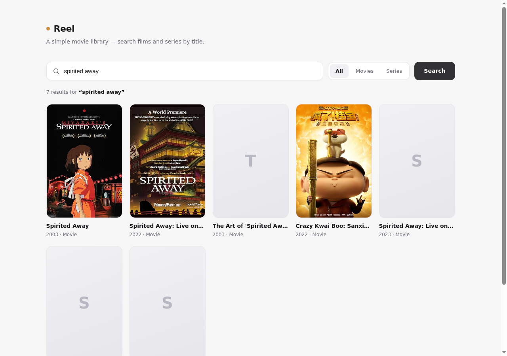
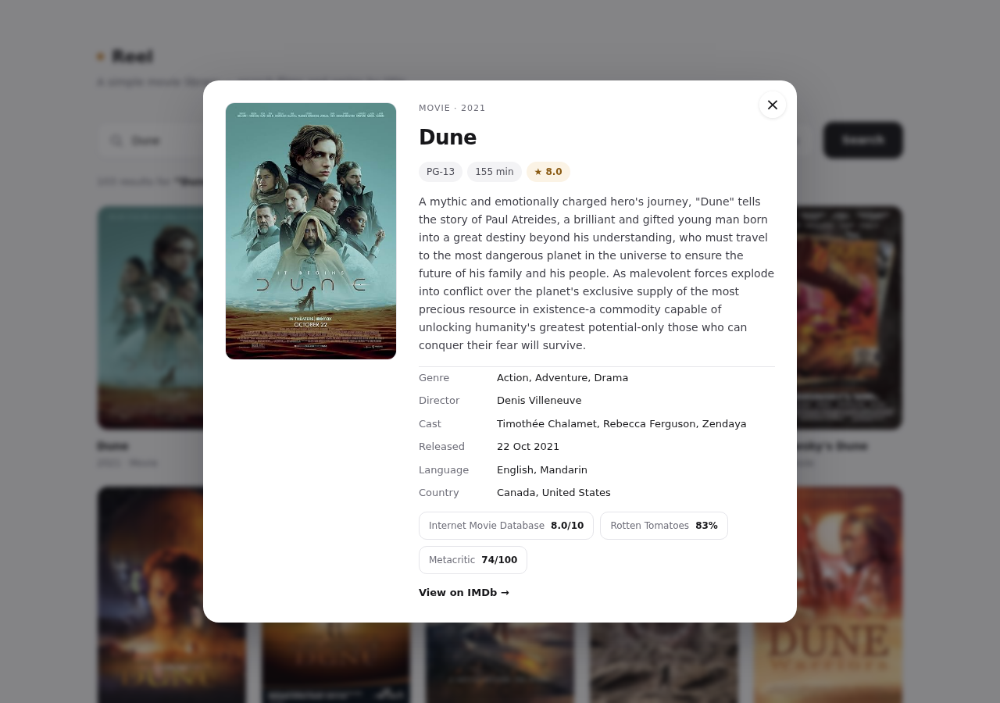

# Reel — movie search

A small, clean movie library built on the [OMDb API](https://www.omdbapi.com/). Search films
and series by title, filter by type, browse posters, and open any title for its full details.





## Features

- Search movies and series by title (Enter or the Search button)
- Filter results by All / Movies / Series
- Poster grid with "Load more" paging (10 per page, up to 100 results per query)
- Detail view with plot, cast, crew, runtime and aggregated ratings
- Loading skeletons, empty states and readable API errors
- Responsive layout, keyboard friendly (Esc closes the detail view)

## Getting started

```bash
npm install
npm run dev
```

The dev server runs at http://localhost:3000.

To build for production:

```bash
npm run build
npm run preview
```

## API key

The OMDb API needs a free key. Out of the box the app uses OMDb's public sample key
(`trilogy`), which is rate limited — fine for a demo, not for real traffic.

Use your own key by creating a `.env` file (see `.env.example`):

```bash
VITE_OMDB_API_KEY=your-key-here
```

Get a key at https://www.omdbapi.com/apikey.aspx. Note that Vite inlines `VITE_*` values into
the browser bundle, so the key is visible to anyone using the app — that is how OMDb's client-side
API is normally used. For a public deployment, proxy the requests through a small server instead.

## Structure

```
src/
  api.ts                  OMDb client, types and error messages
  App.tsx                 search state, filters, paging, layout
  components/MovieCard.tsx   poster card
  components/MovieModal.tsx  detail dialog
  index.css               all styles (plain CSS, no framework)
```

Built with React 19, TypeScript and Vite. No UI library.
